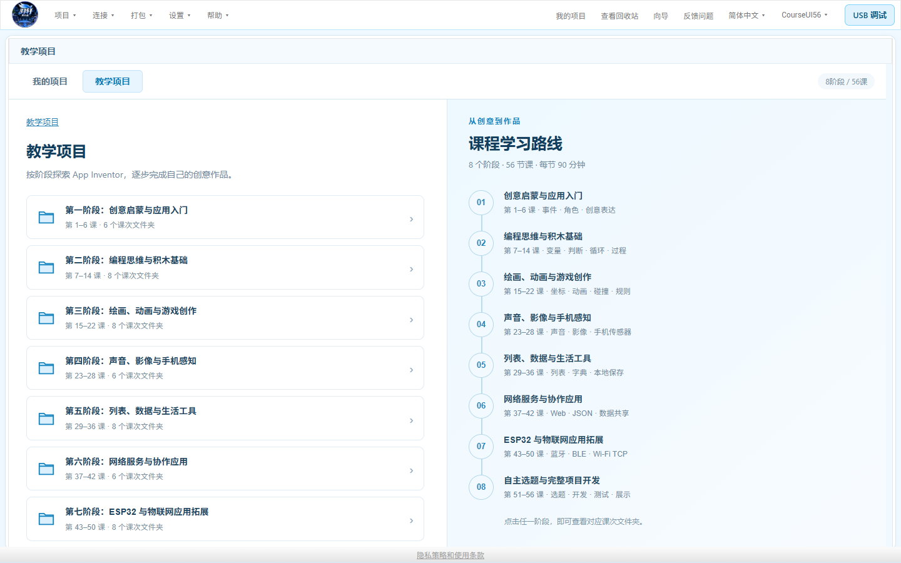

# 羽轩编程工作台 · Yuxuan Programming Studio

Windows x64 本地编程平台，集成 App Inventor、Mixly 桌面编程、Python 和 C++。当前版本 **2.4.5 完整安装版**。

## 直接下载与安装

**[下载2.4.5完整安装包](https://github.com/xiaoyuxuanran/Yuxuan_Programming_Studio/releases/download/v2.4.5/AppInventor-Offline-Setup-x64.exe)** · [GitHub发布页](https://github.com/xiaoyuxuanran/Yuxuan_Programming_Studio/releases/tag/v2.4.5) · [Gitee版本页](https://gitee.com/studentcodeone/yuxuan_-programming_-studio/releases/tag/v2.4.5)

本版可在新电脑直接安装，无需先装2.2.0或其他旧版。完整包包含四类编辑器、Java/Python/C++运行及编译环境、Mixly四类硬件支持、全部56课本地教学资料；不需要另装WSL。

已有版本请保存工程、退出工作台及代码窗口，再安装到原目录。覆盖安装保留个人项目、第三方依赖和授权信息；原有客户端的“检查更新”也能获取本版完整安装包。[安装与升级说明](docs/UPGRADE-2.4.5.md)。

首次使用仍需联网激活，之后可在授权有效期内离线使用；联网时校验授权。公开附件不包含激活码或已激活凭证。

本次为完整安装分发，功能沿用2.3.4。大安装包由GitHub提供；Gitee同步源码、版本说明、更新清单及可容纳的附件。软件优先读取Gitee清单，安装包校验大小与SHA256。

## 包含56课教学项目

8阶段、56课，每课90分钟，共84小时。每课含完整答案、课堂支架、纯界面起始版，共168个工程；本地资料含可编辑PPT及备注、教案、任务单、素材、积木参考图及答案APK。网络课附Python课堂服务，ESP32课附串口、经典蓝牙、BLE、Wi-Fi TCP固件和接线说明。

App Inventor → 我的项目 → 教学项目，即可按阶段与课次使用；中文课程目录可用。课程内容与2.3.4相同，[独立阶段课程包仍可从2.3.4下载](https://github.com/xiaoyuxuanran/Yuxuan_Programming_Studio/releases/tag/v2.3.4)。

168个AIA通过平台导入与积木检查，56份完整答案APK编译完成，56份PPT共1347页逐页渲染检查。未进行Android真机或实物开发板联调。

## 功能与文档

App Inventor 默认经典布局、蓝白主题，支持本机 APK 构建下载、USB 安装运行及应用日志。Python 支持 3.8.9 / 3.13.16、项目环境隔离、Tkinter / Turtle / Pygame、第三方库搜索及清华源安装；C++ 使用内置 Clang++、C++17 和编译缓存。代码编辑器提供文件树、运行结果、基础提示以及 Light / Dark 主题。

主页面提供更新日志、检查更新；优先 Gitee，失败回退 GitHub，下载校验大小和 SHA256。

- [使用说明](docs/使用说明.txt)、[更新日志](CHANGELOG.txt)
- [Mixly 桌面版适配与构建](docs/Mixly桌面版适配说明.md)
- `distribution-source/`：平台源码与适配脚本；`upstream-overlays/`：上游修改；`validation/`：验收脚本。
- [历史 Mixly 网页版说明](docs/Mixly网页版迁移说明.md)，仅对应 2.3.0 / 2.3.1。

本仓库不包含全部预构建依赖。2.4.5 的 `Source-and-Patches.zip` 提供本次源码与补丁；完整上游源码基线沿用 2.2.0 / 2.3.0 发布附件，目录准备见构建说明。

## 许可与验证范围

各上游项目及适配文件沿用原版权声明与许可证，见 `licenses/` 和文件头；Mixly 作者为 Mixly Team@BNU, CHINA，源码与固定提交见适配说明。历史网页源码保留以供追溯。品牌图片不代表上游官方背书。

已验证四类编辑器、草稿反复恢复及进程重启、串口关闭、云库获取及导入、Arduino 本机编译和经典 ESP32 蓝牙生成编译。升级包验证原版安装后的覆盖、重复覆盖、数据保留和合并卸载；未连接真实开发板或 Android 手机。
