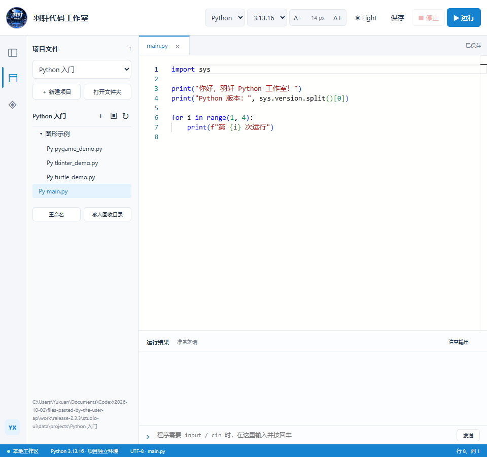

# 羽轩编程工作台 · Yuxuan Programming Studio

Windows x64 本地编程平台，集成 App Inventor、Mixly 桌面编程、Python 和 C++。当前版本 **2.3.3**。

## 下载与升级

[Gitee 分版本下载](https://gitee.com/studentcodeone/yuxuan_-programming_-studio/releases/tag/v2.3.3) · [GitHub 备用](https://github.com/xiaoyuxuanran/Yuxuan_Programming_Studio/releases/tag/v2.3.3)

| 当前版本 | 使用的更新包 |
| --- | --- |
| **2.2.0** | **[直接升级到 2.3.3](https://gitee.com/studentcodeone/yuxuan_-programming_-studio/releases/download/v2.3.3/Yuxuan-Programming-Studio-Update-2.2.0-to-2.3.3.exe)**，无需中间版本 |
| 2.3.1 | [2.3.1 → 2.3.3](https://gitee.com/studentcodeone/yuxuan_-programming_-studio/releases/download/v2.3.3/Yuxuan-Programming-Studio-Update-2.3.1-to-2.3.3.exe) |
| 2.3.2 | [2.3.2 → 2.3.3 小型更新包](https://gitee.com/studentcodeone/yuxuan_-programming_-studio/releases/download/v2.3.3/Yuxuan-Programming-Studio-Update-2.3.2-to-2.3.3.exe) |
| 2.3.0 | 先应用 [2.3.1 增量包](https://gitee.com/studentcodeone/yuxuan_-programming_-studio/releases/tag/v2.3.1)，再应用本版对应更新包 |
| 首次安装 | 安装 [完整 2.2.0](https://github.com/xiaoyuxuanran/Yuxuan_Programming_Studio/releases/tag/v2.2.0)，再使用 2.2.0 直升包 |

保存工程并退出软件，运行匹配的更新包，选择原安装目录。项目、依赖与激活信息保留。**从 Mixly 网页版切回前，请先将工程另存为 `.mix`，再在桌面版打开。** [详细升级说明](docs/UPGRADE-2.3.3.md)。

安装包包含运行环境，无需另装 WSL、Python、C++ 编译器或 Java。首次使用必须联网激活，之后可在授权有效期内离线使用；联网时校验授权状态。公开附件不包含激活码或已激活凭证。

## 本次修改

- Python / C++ 新增 A− / A+ 字号按钮、中间字号恢复默认，以及 Ctrl++ / Ctrl+-、Ctrl+0、Ctrl+滚轮。范围 10–32 px，运行输出同步调整。
- 左侧新增侧栏隐藏/显示按钮与 Ctrl+B；文件/库图标也可收起/展开。字号和侧栏设置保存在工作区，重启和切换语言后保留。

- Mixly 切回 2.2.0 同款 2.0-rc4 桌面客户端，保留 Arduino AVR、Arduino ESP8266、Python ESP32、Arduino ESP32，无仿真入口。
- 修复关闭后重开、刷新时积木被重复复制；同时恢复原积木和手写代码。
- 串口调试弹窗增加可点击、可键盘聚焦的“关闭 ×”按钮。
- 保留云端库和驱动下载，官方主站不可用时使用官方 HTTPS Gitee 云库备用源。
- 保留经典 ESP32 蓝牙串口修复；缩短旧 GCC 内部路径，避免长安装目录下缺少标准库头文件。
- 保留 2.3.1 的 App Inventor 优质扩展 MqttTCP、BluetoothLE、ClientSocketAI2Ext、积木拖拽删除与撤销，以及更新入口。

[C++ 深色主题预览](docs/images/2.3.3-cpp-dark.png)

## 功能与文档

App Inventor 默认经典布局、蓝白主题，支持本机 APK 构建下载、USB 安装运行及应用日志。Python 支持 3.8.9 / 3.13.16、项目环境隔离、Tkinter / Turtle / Pygame、第三方库搜索及清华源安装；C++ 使用内置 Clang++、C++17 和编译缓存。代码编辑器提供文件树、运行结果、基础提示以及 Light / Dark 主题。

主页面提供更新日志、检查更新；优先 Gitee，失败回退 GitHub，下载校验大小和 SHA256。

- [使用说明](docs/使用说明.txt)、[更新日志](CHANGELOG.txt)
- [Mixly 桌面版适配与构建](docs/Mixly桌面版适配说明.md)
- `distribution-source/`：平台源码与适配脚本；`upstream-overlays/`：上游修改；`validation/`：验收脚本。
- [历史 Mixly 网页版说明](docs/Mixly网页版迁移说明.md)，仅对应 2.3.0 / 2.3.1。

本仓库不包含全部预构建依赖。2.3.3 的 `Source-and-Patches.zip` 提供本次源码与补丁；完整上游源码基线沿用 2.2.0 / 2.3.0 发布附件，目录准备见构建说明。

## 许可与验证范围

各上游项目及适配文件沿用原版权声明与许可证，见 `licenses/` 和文件头；Mixly 作者为 Mixly Team@BNU, CHINA，源码与固定提交见适配说明。历史网页源码保留以供追溯。品牌图片不代表上游官方背书。

已验证四类编辑器、草稿反复恢复及进程重启、串口关闭、云库获取及导入、Arduino 本机编译和经典 ESP32 蓝牙生成编译。升级包验证原版安装后的覆盖、重复覆盖、数据保留和合并卸载；未连接真实开发板或 Android 手机。
