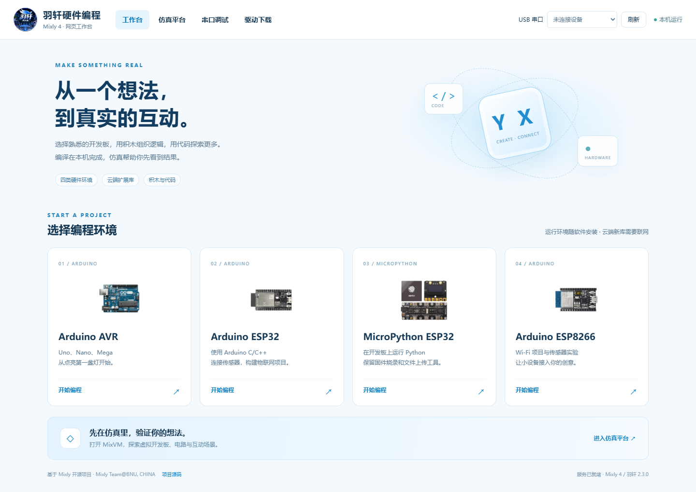

# 羽轩编程工作台 · Yuxuan Programming Studio

面向 Windows x64 的本地编程工具平台，集成 App Inventor、Mixly 网页编程、Python 和 C++。

## 下载与安装

请在 [Gitee 分版本下载](https://gitee.com/studentcodeone/yuxuan_-programming_-studio/releases)（[GitHub 备用](https://github.com/xiaoyuxuanran/Yuxuan_Programming_Studio/releases)）下载安装包。当前版本为 **2.3.1**。

| 版本 | Mixly 界面 | 下载 |
| --- | --- | --- |
| **2.3.1（最新）** | 内置优质扩展、积木拖拽删除、ESP32 蓝牙修复、更新入口 | [2.3.0 → 2.3.1 增量包](https://gitee.com/studentcodeone/yuxuan_-programming_-studio/releases/download/v2.3.1/Yuxuan-Programming-Studio-Update-2.3.0-to-2.3.1.exe) · [升级说明](docs/UPGRADE-2.3.1.md) |
| 2.3.0 | Mixly 4 本机网页工作台，含 MixVM 仿真 | [完整安装包](https://github.com/xiaoyuxuanran/Yuxuan_Programming_Studio/releases/download/v2.3.0/AppInventor-Offline-Setup-x64.exe) · [发布说明](https://github.com/xiaoyuxuanran/Yuxuan_Programming_Studio/releases/tag/v2.3.0) |
| 2.2.0 | 旧 Mixly 2 桌面界面 | [完整安装包](https://github.com/xiaoyuxuanran/Yuxuan_Programming_Studio/releases/download/v2.2.0/AppInventor-Offline-Setup-x64.exe) · [发布说明](https://github.com/xiaoyuxuanran/Yuxuan_Programming_Studio/releases/tag/v2.2.0) |

安装包包含所需运行环境，无需另装 WSL、Python、C++ 编译器或 Java。第一次使用须联网激活；激活后可在授权有效期内离线使用，联网时会校验授权状态。仓库和发布附件不包含激活码或已激活凭证。

### 从旧版升级

已安装完整 2.3.0：保存工程并退出软件，运行 2.3.1 增量包并选择原安装目录。首次安装或当前为 2.2.0：先运行 2.3.0 完整安装包，再应用 2.3.1 增量包。项目、Python 依赖和激活状态保留。升级前请显式保存旧版 Mixly `.mix` 工程；旧草稿与扩展库不会自动迁移，需要在新版中打开工程并重新安装库。

## 功能

- **App Inventor**：经典布局、蓝白主题、本机 APK 构建及下载、USB 安装运行与应用日志入口；内置 MqttTCP、BluetoothLE、ClientSocketAI2Ext，支持将已有积木拖到左侧模块区删除和撤销。
- **Mixly 4 网页工作台**：Arduino AVR、Arduino ESP8266、Arduino ESP32、MicroPython ESP32；MixVM 仿真、云端库、串口调试与驱动下载链接；经典 ESP32 蓝牙串口（SPP，不适用于 C3 / S3）。
- **Python**：3.8.9 / 3.13.16，项目环境隔离，支持 Tkinter、Turtle 和 Pygame，第三方库搜索及清华源安装。
- **C++**：随包 Clang++、C++17、编译缓存。
- Python / C++ 编辑器提供文件树、运行结果、基础代码提示以及 Light / Dark 主题。

主页面可查看更新日志、检查 GitHub 正式版更新，并在校验安装包后升级。[本次更新内容](CHANGELOG.txt)。

主页面可查看更新日志、优先检查 Gitee 正式版更新（失败时回退 GitHub），并在校验安装包后升级。[本次更新内容](CHANGELOG.txt)。

## 文档与源码

- [使用说明](docs/使用说明.txt)
- [Mixly 迁移和构建说明](docs/Mixly网页版迁移说明.md)
- `distribution-source/`：启动器、授权客户端、网页工作区、App Inventor 适配与构建脚本。
- `build-tools/`：构建辅助脚本。
- `validation/`：验收脚本，部分脚本使用原开发目录结构，执行前需按实际路径配置。
- `licenses/`：随产品整理的第三方许可证。

这是 2.3.1 发布源码快照，当前 Git 仓库不含数 GB 的预构建运行环境，也不承诺克隆后无需准备即可构建完整安装包。本版平台源码、适配补丁和新增扩展随 Release 的 `Source-and-Patches.zip` 提供；完整上游源码基线仍见 [2.3.0 的源码附件](https://github.com/xiaoyuxuanran/Yuxuan_Programming_Studio/releases/tag/v2.3.0)。`upstream-overlays/` 保存本次上游修改，固定基线及恢复脚本见构建说明。构建脚本沿用 `work/native` 等原开发目录约定，需结合源码包中的交接说明准备依赖。请勿将个人授权凭证、签名私钥或用户工程提交到仓库。

Mixly 上游为 [Mixly Team@BNU](https://gitee.com/bnu_mixly/mixly4)，固定基线及恢复模块提交见 [UPSTREAM.json](distribution-source/mixly4/UPSTREAM.json)。本次未加入 MixMO / Android App 制作模块，独立 App Inventor 继续保留。

## 许可与归属

本项目包含多个独立上游项目和适配文件，各文件沿用其原有版权声明及许可证；请查看 `licenses/` 和源码文件头。公开发布不代表所有文件采用同一许可证。品牌图片不作为第三方项目的官方标识或背书。

## 验证范围

已验证本机编译、网页编辑与仿真、安装、覆盖安装和卸载保留数据。尚未进行真实开发板烧录、实体串口通信或 Android 真机验证。

## Gitee 镜像

[Gitee 仓库](https://gitee.com/studentcodeone/yuxuan_-programming_-studio) · [分版本下载](https://gitee.com/studentcodeone/yuxuan_-programming_-studio/releases)。更新检查和增量包下载优先使用 Gitee，不可用时回退 GitHub；下载均校验 SHA256。Gitee 单附件上限 100 MB，较大的 2.2.0 / 2.3.0 完整安装包在各版本页面提供 GitHub 链接，2.3.1 增量包直接托管在 Gitee。
