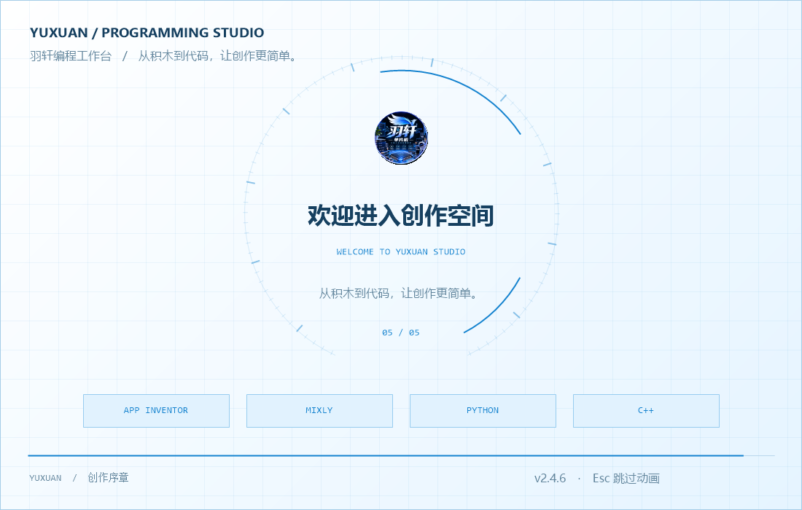

# 羽轩编程工作台 · Yuxuan Programming Studio

Windows x64 本地编程平台，集成 App Inventor、Mixly、Python 和 C++。当前版本 **2.4.6**。

## 下载与安装

- [完整安装包](https://github.com/xiaoyuxuanran/Yuxuan_Programming_Studio/releases/download/v2.4.6/AppInventor-Offline-Setup-x64.exe)：可直接全新安装，默认全选；也可只安装四个项目中的一个或任意多个。
- [2.4.5 → 2.4.6 增量包](https://github.com/xiaoyuxuanran/Yuxuan_Programming_Studio/releases/download/v2.4.6/Yuxuan-Programming-Studio-Update-2.4.5-to-2.4.6.exe)：兼容原版及已安装启动动画补丁的 2.4.5，没有组件选择页。
- [GitHub 发布页](https://github.com/xiaoyuxuanran/Yuxuan_Programming_Studio/releases/tag/v2.4.6) · [Gitee 版本页](https://gitee.com/studentcodeone/yuxuan_-programming_-studio/releases/tag/v2.4.6)。软件优先使用 Gitee 更新清单和可用附件，完整大安装包由 GitHub 提供。

已有版本请保存项目、退出软件后安装到原目录。更早版本使用完整包覆盖升级。再次运行完整包可以添加项目，不删除已经安装的项目。共享启动器和授权运行依赖自动安装；仅安装 C++ 也会包含用于启动器和后台服务的私有 Python 3.13 运行时。

## 新增启动动画

羽轩 Logo、蓝白配色、环形刻度、五段标题、英文逐字显示和揭幕转场，约 7 秒后自动进入启动器。Esc 或右上角按钮可随时跳过；快捷方式添加 `--no-startup-animation` 可关闭。动画之后仍按原流程校验授权，首次使用需联网激活，之后在有效期内允许离线使用。

完整包可选择 App Inventor、Mixly、Python、C++ 中的一项或多项。未安装入口明确标记并禁用；Python/C++ 工作区仅允许切换到已安装的语言。[安装与升级说明](docs/UPGRADE-2.4.6.md)。

App Inventor 包含 8 阶段 56 课、168 个 AIA、PPT、教案、任务单和配套素材。课程内容沿用 2.3.4；[独立阶段课程包](https://github.com/xiaoyuxuanran/Yuxuan_Programming_Studio/releases/tag/v2.3.4)仍然可用。

首次激活、离线有效期及联网校验规则保留。公开附件不含激活码或已激活凭证。

## 功能与文档

App Inventor 默认经典布局、蓝白主题，支持本机 APK 构建下载、USB 安装运行及应用日志。Python 支持 3.8.9 / 3.13.16、项目环境隔离、Tkinter / Turtle / Pygame、第三方库搜索及清华源安装；C++ 使用内置 Clang++、C++17 和编译缓存。代码编辑器提供文件树、运行结果、基础提示以及 Light / Dark 主题。

主页面提供更新日志、检查更新；优先 Gitee，失败回退 GitHub，下载校验大小和 SHA256。

- [使用说明](docs/使用说明.txt)、[更新日志](CHANGELOG.txt)
- [Mixly 桌面版适配与构建](docs/Mixly桌面版适配说明.md)
- `distribution-source/`：平台源码与适配脚本；`upstream-overlays/`：上游修改；`validation/`：验收脚本。
- [历史 Mixly 网页版说明](docs/Mixly网页版迁移说明.md)，仅对应 2.3.0 / 2.3.1。

本仓库不包含全部预构建依赖。2.4.6 的 `Source-and-Patches.zip` 提供本次源码与补丁；完整上游源码基线沿用 2.2.0 / 2.3.0 发布附件，目录准备见构建说明。

## 许可与验证范围

各上游项目及适配文件沿用原版权声明与许可证，见 `licenses/` 和文件头；Mixly 作者为 Mixly Team@BNU, CHINA，源码与固定提交见适配说明。历史网页源码保留以供追溯。品牌图片不代表上游官方背书。

已验证四类编辑器、草稿反复恢复及进程重启、串口关闭、云库获取及导入、Arduino 本机编译和经典 ESP32 蓝牙生成编译。升级包验证原版安装后的覆盖、重复覆盖、数据保留和合并卸载；未连接真实开发板或 Android 手机。
